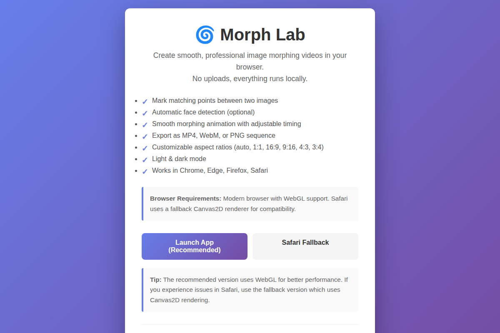

# Morph Lab Screenshots

This guide describes each screenshot in the `screenshots/` folder.

## 1. Landing Page (`01-landing-page.png`)

The welcoming entry point to Morph Lab. Shows:
- **Title & Description**: Eye-catching introduction with gradient background
- **Feature List**: Bullet points highlighting core capabilities
- **Action Buttons**: 
  - "Launch App (Recommended)" → opens the WebGL version
  - "Safari Fallback" → opens the Canvas2D version
- **Info Box**: Browser requirements and version note
- **Footer**: Links to manual and license

**Use case:** First impression for users visiting the project.

---

## 2. Main App – Light Mode (`02-main-app-light.png`)

The primary interface in light theme. Shows:
- **Header**: 
  - Morph Lab title with icon
  - Dark mode toggle (🌙)
  - Mode selector: Single Pair / Batch Sequence
  - Settings gear icon (⚙️)
- **View Tabs**: "start · end images" (active) and "rendered" (hidden, appears after render)
- **Main Canvas Area**: 
  - START image panel (left) with "jpg or png" upload hint
  - END image panel (right)
- **Below Images**: 
  - Face Mode toggle (off / on)
  - (Hidden) Render button (appears when both images loaded)
- **Interface theme**: Clean, bright, high contrast

**Use case:** Demonstrating the clean light interface.

---

## 3. Main App – Dark Mode (`03-main-app-dark.png`)

The same interface in dark theme. Shows:
- **Header**: Same layout, but with light text on dark background
- **Theme Toggle**: Shows ☀️ (click to switch to light mode)
- **Canvas Area**: Dark background reduces eye strain
- **Point Markers**: Bright colors stand out against dark canvas
- **Interface theme**: Comfortable for low-light environments

**Use case:** Showing dark mode support and preference customization.

---

## 4. Settings Popout – Format Tab (`04-settings-format.png`)

The Settings popout opened to the Format tab. Shows:
- **Popout Header**: 
  - Format / Export tabs (Format is active)
  - Close button (X)
- **Format Tab Content**:
  - "FORMAT" label
  - Aspect ratio buttons: auto (active), 1:1, 16:9, 9:16, 4:3, 3:4
  - Help text explaining what aspect ratio does
- **Popout Positioning**: Anchored to the gear icon, positioned absolutely
- **Z-Index Handling**: Sits above image canvases

**Use case:** Showing Settings UI and Format customization options.

---

## 5. Settings Popout – Export Tab (`05-settings-export.png`)

The Settings popout switched to the Export tab. Shows:
- **Export Tab Header**: "EXPORT SETTINGS" label with resolution info
- **Export Controls**:
  - Hold per image: Slider (2.0s default)
  - Transition: Slider (5.0s default)
  - FPS: Slider (30 default)
- **Video Format Toggle**:
  - mp4 (active, default)
  - webm
- **Help Text**: Explanation of MP4 vs. WebM differences
- **Export Button**: "export PNG sequence" (disabled until images loaded)
- **Popout Style**: Consistent with Format tab

**Use case:** Demonstrating export settings and render configuration.

---

## 6. Batch Mode (`06-batch-mode.png`)

The interface switched to Batch Sequence mode. Shows:
- **Header Mode Tab**: "Batch Sequence" is now active
- **Main Area Changes**:
  - Drop zone: "drop a folder of JPEGs/PNGs here"
  - File picker buttons: "choose a folder" / "choose files"
  - Batch info: "X / X images loaded"
  - Thumbnail strip: (empty until images added)
- **Points Card**: Appears when 2+ images are loaded
  - "TRANSITION POINTS (OPTIONAL)" header
  - Navigation: "prev" / "next" buttons
  - Current transition counter: "transition 1 of 2"
  - "copy from previous" button
  - Two image panels (showing consecutive pair)

**Use case:** Showing Batch mode for morphing image sequences.

---

## How to Use These Screenshots

### In Documentation
```markdown

```

### In README
Embed 2–3 key screenshots (landing, main interface, settings) to give visitors a quick visual overview.

### In GitHub Wiki
Link to individual screenshots for step-by-step tutorials.

### On Social Media
Use 02 or 03 (main interface) for a quick visual demo.

---

## Screenshot Specifications

| Screenshot | Dimensions | Format | Size | Theme |
|-----------|------------|--------|------|-------|
| 01-landing-page.png | 1200×800 | PNG | 352 KB | Light (gradient BG) |
| 02-main-app-light.png | 1200×800 | PNG | 30 KB | Light |
| 03-main-app-dark.png | 1200×800 | PNG | 30 KB | Dark |
| 04-settings-format.png | 1200×800 | PNG | 49 KB | Light |
| 05-settings-export.png | 1200×800 | PNG | 60 KB | Light |
| 06-batch-mode.png | 1200×800 | PNG | 45 KB | Light |

**Total size:** ~576 KB (highly compressible for CDN)

---

## Updating Screenshots

If you update the UI:

1. **Repeat the screenshot capture** (see below)
2. **Update version numbers** in filenames if major layout changes
3. **Rebuild documentation** with new visuals

### How to Recreate

```python
# Run the screenshot script:
python3 screenshots_generate.py
```

(See `CONTRIBUTING.md` for development setup)

---

**Last updated:** October 24, 2026  
**Screenshots captured at:** 1200×800 (desktop resolution for GitHub visibility)
